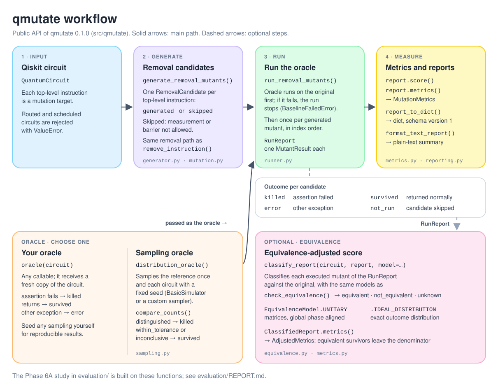

# qmutate

qmutate is an early-stage Python library for mutation testing of quantum circuits built with
[Qiskit](https://www.ibm.com/quantum/qiskit). It removes one instruction at a time from a circuit, runs
your test oracle against every such mutant, and reports which mutants your tests detect. It also
offers numerical equivalence checks (exact models, within a tolerance) and a finite-shot sampling
oracle whose verdicts carry statistical guarantees under stated assumptions.

**Status: pre-alpha.** The API may change. qmutate is not published on PyPI; install it from source as
described in [Requirements and installation](#requirements-and-installation).

## Why mutation testing for quantum circuits

A passing test suite for a quantum program does not show that the tests would catch a bug. Mutation
testing measures this directly: it injects small, controlled faults (mutants) into a circuit and checks
whether the tests fail. Quantum circuits make this harder than classical code:
- outputs are probabilistic;
- many faults change results only slightly;
- some mutants are equivalent to the original circuit and can never be detected.

qmutate provides building blocks for this workflow, with explicit rules for each of these problems.

## Features

| Area | Public API | Module |
|---|---|---|
| Mutation operator | `remove_instruction`: removes one top-level instruction and never modifies its input | `mutation.py` |
| Mutant enumeration | `generate_removal_mutants`, `RemovalCandidate`, `CandidateStatus`, `SkipReason` | `generator.py` |
| Running an oracle | `run_removal_mutants`, `RunReport`, `MutantResult`, `MutantOutcome`, `BaselineFailedError` | `runner.py` |
| Metrics | `mutation_score`, `MutationMetrics`, `AdjustedMetrics` | `metrics.py` |
| Reports | `report_to_dict` (JSON-compatible, schema version 1), `format_text_report` | `reporting.py` |
| Equivalence | `check_equivalence`, `classify_report`, `ClassifiedReport`, `EquivalenceModel`, `EquivalenceResult`, `EquivalenceVerdict`, `UnknownReason` | `equivalence.py` |
| Sampling | `sample_counts`, `compare_counts`, `DistributionComparison`, `SamplingVerdict`, `distribution_oracle`, `DistributionOracle`, `shots_for_threshold`, `family_delta` | `sampling.py` |

There is one mutation operator: removal of a single top-level instruction. Everything listed under
[Roadmap](#roadmap) is planned, not implemented.

## How it fits together



## Requirements and installation

- Python `>=3.11` and `qiskit>=2.0,<3`, as declared in `pyproject.toml`; the only other runtime
  dependencies are Qiskit's own.
- `pytest>=8,<10` for the tests (the `test` extra).

See [Verified versions](#verified-versions) for what has actually been tested.

Get the source and change into the project directory:

```bash
git clone https://github.com/rasidi3112/qmutate.git
```

```bash
cd qmutate
```

With [uv](https://docs.astral.sh/uv/), from the project directory:

```bash
uv venv --python 3.11
```

```bash
uv pip install -e ".[test]"
```

With pip, inside an activated virtual environment that has pip:

```bash
python -m pip install -e ".[test]"
```

qmutate must be installed (editable or not) to be imported, because `qmutate.__version__` is read from
the installed package metadata.

## Quick start

Run an oracle against every removal mutant of a circuit and read the mutation score:

```python
from qiskit import QuantumCircuit
from qiskit.quantum_info import Operator
from qmutate import run_removal_mutants

circuit = QuantumCircuit(2)
circuit.h(0)
circuit.barrier()
circuit.cx(0, 1)
expected = Operator(circuit)


def oracle(candidate):
    assert Operator(candidate).equiv(expected)


report = run_removal_mutants(circuit, oracle, allow_barrier=True)
for result in report.results:
    print(result.candidate.index, result.candidate.name, result.outcome)
print(report.score())
```

```text
0 h killed
1 barrier survived
2 cx killed
0.6666666666666666
```

The oracle kills the `h` and `cx` mutants. Removing the barrier does not change the unitary, so that
mutant survives and lowers the score.

## Workflow at a Glance

These six panels walk through the [Quick start](#quick-start) example from input to report. They are
conceptual illustrations of that small synthetic example, not research results: every result shown
(outcomes, verdicts, scores and report) is the output of that example.
[How it fits together](#how-it-fits-together) has a one-page overview of the public API.

**1. Input circuit and test configuration**


**2. Mutation generation**


**3. Mutant execution**


**4. Oracle evaluation**


**5. Equivalence classification**


**6. Mutation score and report**


## Usage

### Removing one instruction

```python
from qiskit import QuantumCircuit
from qmutate import mutation_score, remove_instruction

circuit = QuantumCircuit(2, 2)
circuit.h(0)
circuit.cx(0, 1)
circuit.measure([0, 1], [0, 1])

mutant = remove_instruction(circuit, 1)
print(dict(mutant.count_ops()))

print(mutation_score(killed=3, eligible=4))
```

```text
{'measure': 2, 'h': 1}
0.75
```

`remove_instruction` returns a new circuit and never modifies its input. Isolation between the mutant
and the original is partial, and the guarantees below were verified with Qiskit 2.0.3 and 2.6.1 only:

- **Isolated:** editing these on the mutant leaves the original unchanged:
  - instruction objects and their labels, at top level, inside control-flow blocks and inside
    definitions of non-gate instructions (all recursively);
  - control-flow blocks;
  - non-scalar instruction parameters such as NumPy arrays;
  - definitions of non-gate instructions;
  - the definition circuit of a `Gate`;
  - metadata and layout.
- **Copied by policy:**
  - Name, global phase, registers, bits and typed classical variables are kept; registers, bits and
    variables are the same immutable objects as in the original.
  - Parameters compare equal to the original `Parameter` objects and can be bound with them, but may be
    different Python objects.
  - The initial layout is kept; routed and scheduled circuits are rejected.
- **Not guaranteed independent:** contents of `Gate` definitions, attributes outside `params`, `label`,
  `definition` and control-flow blocks (for example `PauliEvolutionGate.operator`), and operations that
  are not `Instruction` objects. See [Known limitations](#known-limitations).

Measurements and barriers, including ones nested inside custom instructions or control-flow blocks, can
only be removed with `allow_measure=True` or `allow_barrier=True`. An opaque non-gate instruction that
acts on classical bits is treated as a possible measurement. `Gate` definitions are not inspected.

- Removing a measurement removes the readout and the collapse of the qubit. Later quantum operations and
  classical conditions can change, and the classical bit keeps its previous value: an earlier write, or
  the backend's initial value. If a later measurement overwrites the same bit, the mutant may be
  equivalent.
- Removing a barrier does not change the ideal unitary or ideal output distribution, but it can change
  transpilation, scheduling, circuit structure and results on noisy hardware.

Routed circuits (with a `final_layout`) and scheduled circuits (with `op_start_times`) are rejected
with `ValueError`, because removing an instruction would leave that metadata invalid.

### Enumerating mutants

```python
from qiskit import QuantumCircuit
from qmutate import generate_removal_mutants

circuit = QuantumCircuit(2, 2)
circuit.h(0)
circuit.cx(0, 1)
circuit.measure([0, 1], [0, 1])

for candidate in generate_removal_mutants(circuit):
    print(candidate.index, candidate.name, candidate.status, candidate.skip_reason)
```

```text
0 h generated None
1 cx generated None
2 measure skipped measurement_not_allowed
3 measure skipped measurement_not_allowed
```

`generate_removal_mutants` returns a list with one `RemovalCandidate` per top-level instruction, in the
order of `circuit.data`. Each record holds:
- the original `index`;
- the operation `name`;
- a `status`, `generated` or `skipped`;
- the `mutant` circuit, or `None`;
- a `skip_reason`, or `None`.

Behaviour:
- Every candidate goes through the same internal removal path as `remove_instruction`: one isolated
  copy is made, the policy is checked on it, and the mutant is built from that same copy. Each generated
  mutant removes exactly one top-level instruction and follows the isolation and copying rules above.
  The input circuit is not modified.
- The order and indices of the candidates are always deterministic. The statuses, skip reasons and
  mutants are deterministic, and a generated mutant equals what a separate `remove_instruction` call
  returns, only when every operation's definition is deterministic. Definitions are built lazily on
  copies, so an operation whose definition changes between builds or depends on outside state can be
  classified differently by different calls, and a separate `remove_instruction` call can then decide
  differently. Within one call, each candidate's status and mutant always come from the same check.
- A candidate is skipped exactly when that check refuses it, and exactly one reason is reported:
  - `measurement_not_allowed` if the operation is or may contain a measurement and `allow_measure` is
    false;
  - otherwise `barrier_not_allowed` if it is or contains a barrier and `allow_barrier` is false.

  An operation containing both therefore reports `measurement_not_allowed` by default, and
  `barrier_not_allowed` once `allow_measure=True` is passed. Pass both flags to generate it.
- `RemovalCandidate` checks its fields on construction:
  - `status` must be a `CandidateStatus`;
  - `skip_reason` must be a `SkipReason` or `None`;
  - a generated candidate needs a mutant and no reason;
  - a skipped candidate needs a reason and no mutant.

  Candidates are hashable. The hash ignores the mutant and never changes, so equal candidates always
  have equal hashes.
- Candidate equality compares mutants with `QuantumCircuit.__eq__`. That comparison is structural and
  ignores circuit name and metadata. It is not quantum semantic equivalence, so mutants with the same
  unitary but different instructions are unequal, and a `set` of candidates does not remove equivalent
  mutants.
- Equality follows the mutant's current contents. If you edit a candidate's mutant in place after
  putting the candidate in a `set` or using it as a `dict` key, that candidate is still found, but
  another candidate that used to be equal to it no longer matches.
- Any other error while creating a mutant is raised, not reported as a skip.
- Routed and scheduled circuits are rejected as a whole with `ValueError` before any candidate is
  considered, even when they have no instructions.
- Candidates are only generated mutants. They say nothing about equivalence or whether a test suite
  kills them.

### Running an oracle against mutants

`run_removal_mutants(circuit, oracle, *, allow_measure=False, allow_barrier=False)` returns a
`RunReport` (see the [Quick start](#quick-start)) with one `MutantResult` per top-level instruction, in
index order, and the counts `killed`, `survived`, `errors` and `not_run`.

**The oracle:**
- It is a callable that receives a `QuantumCircuit`.
- Raising `AssertionError` (a plain `assert`, or `numpy.testing` assertions) means the mutant is
  `killed`.
- Returning normally means `survived`, whatever the return value.
- Any other `Exception` means `error`, and `MutantResult.error_type` holds the exception's class name;
  it is `None` for every other outcome.
- `KeyboardInterrupt`, `SystemExit` and other exceptions that do not derive from `Exception` are never
  caught. This includes `pytest.fail` and `pytest.skip`, so use `assert` rather than `pytest.fail` inside
  an oracle.

**The run:**
- The oracle runs on the original circuit first. If it raises there, the run stops with
  `BaselineFailedError` before any mutant is run; the oracle's exception is its `__cause__`, and it is
  not counted in `errors`.
- The oracle is called exactly once per generated candidate, in index order. Skipped candidates are
  `not_run`, and the oracle is not called for them.
- The oracle never receives the original circuit or a stored mutant. Each call gets a fresh copy made
  with the same isolation rules as `remove_instruction`, so most edits made by the oracle do not reach
  the original circuit or the report. State that those rules do not isolate, such as
  `PauliEvolutionGate.operator`, is still shared, so oracles should not modify their input.
- The runner adds no randomness. Results are only as reproducible as the oracle; an oracle that samples
  should fix its seeds, for example with `seed_simulator`.

**The report:**
- `report.score()` is `mutation_score(killed, killed + survived)`: `error` and `not_run` results are
  excluded, and it raises `ZeroDivisionError` when no mutant was killed or survived. A surviving mutant
  may be equivalent to the original; the runner does not detect that (see
  [Equivalence checks](#equivalence-checks-and-adjusted-metrics)).
- `MutantResult` and `RunReport` check their fields on construction: outcomes must be `MutantOutcome`
  values, `not_run` must match skipped candidates, `error_type` is set only for `error`, results must be
  in index order, and the counts must match the results.

### Metrics, reports and output format

```python
import json

from qiskit import QuantumCircuit
from qiskit.quantum_info import Operator
from qmutate import format_text_report, report_to_dict, run_removal_mutants

circuit = QuantumCircuit(2)
circuit.h(0)
circuit.barrier()
circuit.cx(0, 1)
expected = Operator(circuit)


def oracle(candidate):
    assert Operator(candidate).equiv(expected)


report = run_removal_mutants(circuit, oracle)
metrics = report.metrics()
print(metrics.total, metrics.executed, metrics.eligible, metrics.score, metrics.error_rate)
print(json.dumps(report_to_dict(report)["summary"]))
print(format_text_report(report))
```

```text
3 2 2 1.0 0.0
{"total": 3, "killed": 2, "survived": 0, "errors": 0, "not_run": 1, "executed": 2, "eligible": 2, "score": 1.0, "error_rate": 0.0}
qmutate removal mutants: 3 candidates
killed 2 | survived 0 | error 0 | not run 1
mutation score: 100.00% (2 of 2 killed; error and not_run excluded)
error rate: 0.00% (0 of 2 executed)

index  instruction  outcome  detail
0      h            killed
1      barrier      not_run  barrier_not_allowed
2      cx           killed
```

This is the circuit and oracle of the [Quick start](#quick-start), run without `allow_barrier=True`,
so the barrier is not run.

`MutationMetrics` stores the four counts `killed`, `survived`, `errors` and `not_run`, rejects booleans,
other non-`int` values and negative counts, and derives everything else from them:

| Value | Definition |
|---|---|
| `total` | all four counts |
| `executed` | `killed + survived + errors`: mutants the oracle ran on |
| `eligible` | `killed + survived`: the mutation-score denominator |
| `score` | `mutation_score(killed, eligible)`, or `None` when `eligible` is zero |
| `error_rate` | `errors / executed`, or `None` when `executed` is zero |

`error` and `not_run` are never part of the score. `RunReport.metrics()` builds a `MutationMetrics`
from a report. Its `score` equals `RunReport.score()` whenever that is defined, and is `None` where
`RunReport.score()` and `mutation_score` raise `ZeroDivisionError`.

**Output format.** Continuing the example above, `report_to_dict(report)` returns the structured report,
schema version 1:

```python
print(json.dumps(report_to_dict(report), indent=2))
```

```text
{
  "schema_version": 1,
  "summary": {
    "total": 3,
    "killed": 2,
    "survived": 0,
    "errors": 0,
    "not_run": 1,
    "executed": 2,
    "eligible": 2,
    "score": 1.0,
    "error_rate": 0.0
  },
  "mutants": [
    {
      "index": 0,
      "name": "h",
      "outcome": "killed",
      "skip_reason": null,
      "error_type": null
    },
    {
      "index": 1,
      "name": "barrier",
      "outcome": "not_run",
      "skip_reason": "barrier_not_allowed",
      "error_type": null
    },
    {
      "index": 2,
      "name": "cx",
      "outcome": "killed",
      "skip_reason": null,
      "error_type": null
    }
  ]
}
```

- `schema_version` is currently `1`.
- `summary` holds the values of the table above.
- There is one `mutants` entry per candidate, in index order. Every entry has `index`, `name`,
  `outcome` (`killed`, `survived`, `error` or `not_run`), `skip_reason` and `error_type`.
  `skip_reason` is `null` except for `not_run`, and `error_type` is `null` except for `error`.

The dictionary contains only plain strings, numbers, `None`, lists and dictionaries. It keeps full float
precision and has a stable key order, so the same report always gives an equal dictionary. It contains
no circuits, versions, timestamps or other environment details. The exact bytes of a JSON encoding are
not specified.

`format_text_report(report)` is built from `report_to_dict(report)`. It shows rates as percentages
rounded to two decimals, an undefined rate as `undefined`, and a note when any mutant survived. Columns
are padded by character count, so wide Unicode characters may not line up visually. Neither function
writes files or prints.

### Equivalence checks and adjusted metrics

```python
import math

from qiskit import QuantumCircuit
from qiskit.quantum_info import Operator
from qmutate import EquivalenceModel, classify_report, run_removal_mutants

circuit = QuantumCircuit(1)
circuit.h(0)
circuit.rz(2 * math.pi, 0)
circuit.x(0)
expected = Operator(circuit)


def oracle(candidate):
    assert Operator(candidate).equiv(expected)


report = run_removal_mutants(circuit, oracle)
classified = classify_report(circuit, report, model=EquivalenceModel.UNITARY)
for result, verdict in zip(report.results, classified.results):
    print(result.candidate.name, result.outcome, verdict.verdict)
metrics = classified.metrics()
print(metrics.base.score, metrics.adjusted_score)
```

```text
h killed not_equivalent
rz survived equivalent
x killed not_equivalent
0.6666666666666666 1.0
```

`rz(2π)` equals `−I`, which differs from the identity only by a global phase. Its removal therefore
survives the oracle and is classified as equivalent. The base score counts that survivor (2 of 3); the
adjusted score leaves it out (2 of 2).

`check_equivalence(original, mutant, *, model, atol=1e-8, max_qubits=None)` compares two circuits
exactly, within a numerical tolerance, under one of two models. Verdicts are `equivalent`,
`not_equivalent` or `unknown`; an `unknown` result carries a stable `UnknownReason` and no differences.

**`EquivalenceModel.UNITARY`** compares the circuits' matrices for circuits made of gates, barriers and
delays.
- The global phase is aligned by `e^{iφ} = t / |t|` with `t = trace(V† U)` (`1` when `t` is zero).
- `max_difference` is the largest entry-wise `|U_ij − e^{iφ} V_ij|`. The verdict is `equivalent` exactly
  when `max_difference ≤ atol`.
- This phase minimises the Frobenius norm, not the largest entry, so `max_difference` can exceed the
  smallest value achievable with any global phase, `m*`. Proven bound:
  `m* ≤ max_difference ≤ min(2, 2ⁿ·m*, (1 + 2·2^{n/2})·m*)` for `n` qubits. No tighter factor, such as
  `2^{n/2}`, is claimed. The test suite checks the proven bound on seeded random cases with up to 3
  qubits, which checks the implementation but is not a proof.

**`EquivalenceModel.IDEAL_DISTRIBUTION`** compares the exact probability distribution of all classical
bits when the circuit starts from `|0…0⟩`.
- Measurements must be terminal: after a qubit is measured, only further measurements, barriers and
  delays may act on it.
- A qubit measured into several classical bits writes the same value to each, a bit written more than
  once keeps the last value, and a bit never written is `0`. Every classical bit must belong to a
  register.
- `max_difference` is the largest difference in a single outcome probability, and `total_variation` is
  half the sum of all differences. The verdict is `equivalent` exactly when `total_variation ≤ atol`.

**`unknown` reasons**, checked in this order:
1. `unbound_parameters`;
2. `too_many_qubits` (defaults: 10 qubits for the unitary model, 16 for the distribution model);
3. `clbits_outside_registers` (distribution model);
4. the first unsupported instruction: `measurement` in the unitary model, `reset`, `control_flow`,
   `non_gate_instruction`, `mid_circuit_measurement`;
5. `no_measurements` (distribution model).

Only when none of these applies is the circuit prepared for comparison: in the unitary model its matrix
is built; in the distribution model a gates-only copy is assembled and its statevector is built.
- Any `QiskitError`, including subclasses such as `CircuitError`, raised during this preparation gives
  `unsupported_operation`. That covers operations Qiskit cannot simulate, such as a gate with neither a
  matrix nor a definition. It also covers a `QiskitError` raised by a custom gate's own code, for
  example in its `_define`. So `unsupported_operation` means preparation failed with a `QiskitError`,
  not that the operation is certainly unsupported.
- Exceptions of any other type, such as a `RuntimeError` from a custom gate's `_define`, propagate
  unchanged.
- The original circuit is checked completely before the mutant, so its reason is reported first.

Both circuits are copied first, so neither is modified. Verdicts are numerical, not symbolic proofs,
and say nothing about noise, other starting states or other measurement bases.

`classify_report(circuit, report, *, model, atol=1e-8, max_qubits=None)` classifies every mutant stored
in a `RunReport` against the original circuit. It returns a `ClassifiedReport` that keeps the report and
the verdicts together, with `None` for candidates that were not run.

Before classifying, it checks that `circuit` matches the run's instructions:
- the same number of top-level instructions and the same instruction names;
- every mutant equal to `circuit` with exactly its candidate's instruction removed, compared with
  Qiskit's instruction equality (operations, parameters, and the qubits and classical bits they act on);
- every mutant with the same qubits and classical bits as `circuit`, in the same order, because the
  unitary matrix and the outcome keys depend on bit positions. A circuit whose registers are added in a
  different order is rejected.

A mismatch raises `ValueError`. Other circuit attributes are not compared: global phase, name, metadata
and layout may differ. None of them changes a verdict, because the unitary model aligns global phase,
the distribution model does not depend on it, and neither model uses the layout.

A `ClassifiedReport` can also be constructed directly, but then only its internal structure is
checked: the report type, one entry per result, `None` exactly for `not_run`, and a single model. That
does not show that the verdicts belong to the mutants that were actually run. `classify_report` is the
path that matches the circuit and the candidates against the report.

`ClassifiedReport.metrics()` returns `AdjustedMetrics`:

| Value | Definition |
|---|---|
| `base` | the `MutationMetrics` of the run, unchanged |
| `equivalent_survived`, `equivalent_killed`, `equivalent_errors` | mutants with an `equivalent` verdict, by outcome |
| `adjusted_eligible` | `killed + survived − equivalent_survived` |
| `adjusted_score` | `mutation_score(killed, adjusted_eligible)`, or `None` when that is zero |

Only equivalent survivors leave the denominator:
- Equivalent mutants that were killed stay in both scores and are reported in `equivalent_killed`,
  because killing an equivalent mutant means the oracle observed something outside the model.
- Equivalent errors are informational.
- `not_equivalent` and `unknown` verdicts change nothing, so the adjusted score is never below the base
  score.

Nothing is excluded unless you call `classify_report` and use `AdjustedMetrics`; `RunReport.score()`,
`MutationMetrics` and `report_to_dict` are unchanged.

### Sampling comparison

```python
from qiskit import QuantumCircuit
from qmutate import distribution_oracle, run_removal_mutants

circuit = QuantumCircuit(1, 1)
circuit.h(0)
circuit.barrier()
circuit.measure(0, 0)

oracle = distribution_oracle(circuit, shots=1000, seed=7)
report = run_removal_mutants(circuit, oracle, allow_barrier=True)
for result in report.results:
    print(result.candidate.name, result.outcome)
print(oracle.shots, round(oracle.threshold, 4), oracle.delta, oracle.tolerance, report.score())
```

```text
h killed
barrier survived
measure not_run
1000 0.1276 0.01 0.0 0.5
```

`compare_counts(counts_a, counts_b, *, num_clbits, delta=0.01, tolerance=0.0)` compares two sets of
measurement counts and returns a `DistributionComparison`. It stores the shot totals, `num_clbits`,
`delta`, `tolerance` and the observed total variation `distance`, and derives:

- `threshold`: the sum of both samples' margins, where one sample of `n` shots has margin
  `(sqrt((2**num_clbits - 1) / n) + sqrt(2 * ln(1 / delta) / n)) / 2`;
- `lower_bound = max(0, distance - threshold)` and `upper_bound = min(1, distance + threshold)`;
- `informative`, which is `threshold < 1`;
- `verdict`: `within_tolerance` if `upper_bound <= tolerance`, `distinguished` if
  `lower_bound > tolerance`, otherwise `inconclusive`. With the default `tolerance = 0`, the verdict is
  never `within_tolerance`, and when `informative` is false it is always `inconclusive`.

Count keys are bit strings; spaces between registers are removed and the length must equal
`num_clbits`. Both sets must come from circuits with the same classical-bit layout, which
`compare_counts` cannot check.

**Assumptions.** Every statistical statement below holds only under these assumptions:

- A1: each sample, considered on its own with its seed treated as random, consists of independent,
  identically distributed shots from the circuit's fixed output distribution. qmutate cannot verify
  this. The default sampler draws from Qiskit's `BasicSimulator`; a custom sampler is responsible for
  satisfying A1 itself.
- A2: both samples use the same outcome space of `num_clbits` bits.
- A3: seeds are chosen independently of the circuits and of any results.
- A4: a circuit's output distribution does not change between samples.

**Guarantees under A1–A4.**
- Each sample is outside its margin with probability at most `delta`. By the union bound, which needs
  no independence between samples, the true distance lies in `[lower_bound, upper_bound]` with
  probability at least `1 - 2 * delta`.
- Consequently a `distinguished` verdict when the true distance is at most `tolerance`, and a
  `within_tolerance` verdict when it is greater, each happen with probability at most `2 * delta`.
- A true distance above `tolerance + 2 * threshold` gives `distinguished`, and one below
  `tolerance - 2 * threshold` gives `within_tolerance`, each with probability at least `1 - 2 * delta`.
  Between those limits there is no guarantee.
- These are lower bounds on confidence, not exact levels. The bound is conservative, so small
  differences are often reported as `inconclusive`. `within_tolerance` never means that two circuits
  are equivalent.

| Classical bits | 100 shots | 1,000 | 10,000 | 1,000,000 | Shots for threshold 0.1 |
|---|---|---|---|---|---|
| 1 | 0.403 | 0.128 | 0.040 | 0.004 | 1,629 |
| 3 | 0.568 | 0.180 | 0.057 | 0.006 | 3,227 |
| 5 | 0.860 | 0.272 | 0.086 | 0.009 | 7,401 |
| 10 | 3.502 | 1.107 | 0.350 | 0.035 | 122,635 |

The table shows `threshold` for two samples of equal size with `delta = 0.01`; values of 1 or more can
never give a verdict. `shots_for_threshold(target, num_clbits, delta=0.01)` returns the smallest equal
shot count whose threshold is at most `target`.

`sample_counts(circuit, *, shots, seed, sampler=None)` samples a copy of the circuit and returns counts
with keys ordered as `circuit.clbits`, bit 0 rightmost. Every classical bit must belong to exactly one
register, because for other layouts Qiskit's count keys omit or mislabel bits. A custom `sampler` is
called as `sampler(circuit, shots, seed)` and must return exactly `shots` shots. Sampler errors
propagate.

`distribution_oracle(reference, *, shots, seed, delta=0.01, tolerance=0.0, sampler=None)` samples the
reference once with seed `seed` and returns a frozen `DistributionOracle`.
- Each call samples its circuit with seed `seed + 1`, requires the reference's classical bits and
  registers in the same order, and raises `AssertionError` only for a `distinguished` verdict.
- The oracle exposes `shots`, `seed`, `delta`, `tolerance`, `threshold` and read-only
  `reference_counts`.
- It refuses references that measure nothing and settings whose threshold is 1 or more.

Points to keep in mind:
- **Seeds.** Every call uses the same seed `seed + 1`, so the oracle keeps no state and results do not
  depend on call order. Samples of different circuits are therefore correlated. Circuits with the same
  output distribution often receive identical counts, but not always: `BasicSimulator` samples circuits
  that only measure at the end in one step and simulates other circuits shot by shot, so removing an
  instruction can change how random numbers are used without changing the distribution. This
  correlation does not affect the guarantees, which rely only on each sample's own margin.
- **Reading the score.** In a run, a survived mutant is either `within_tolerance` or `inconclusive`,
  and both lower the score. The score measures how detectable mutants are at this threshold, not how
  good another test suite is, and it is not monotonic in the number of shots. Report `shots`,
  `threshold`, `delta` and `tolerance` with the score, and do not compare scores obtained with different
  settings.
- **Baseline.** The runner first calls the oracle on the original circuit. With `tolerance = 0` that
  comparison is normally `inconclusive`, which passes. If it is `distinguished`, which under A1–A4
  happens with probability at most `2 * delta`, the run stops with `BaselineFailedError`. Its cause is
  the `AssertionError`, and no report or score exists. That indicates a sampling false positive, a
  sampler that violates A1, or a circuit whose distribution changes; it is never a mutation result.
  Changing seeds until the baseline passes breaks A3 and voids every guarantee; choose seeds in
  advance, lower `delta` or check the sampler instead.
- **A whole run.** A run with `g` generated candidates uses `g + 2` samples: the reference, the baseline
  call and one per mutant. With `delta = family_delta(alpha, g + 2)`, the probability of any false
  `distinguished` or false `within_tolerance` in the run is at most `alpha` under A1–A4. Count `g` with
  `generate_removal_mutants` and the same `allow_*` flags as the run.
- **Per-mutant verdicts.** Reports keep schema version 1, so they show only killed and survived. To see
  which survivors were `inconclusive`, call `sample_counts` with seed `seed` for the reference and
  `seed + 1` for each mutant, then `compare_counts` with the same settings; with the same sampler this
  reproduces the oracle's verdicts.

`mutation_score` returns a float in `[0.0, 1.0]`. It receives only two counts and cannot verify how
mutants were classified: the caller must exclude invalid, equivalent and inconclusive mutants from both
counts. It rejects impossible counts such as `killed > eligible`, and raises `ZeroDivisionError` when
there are no eligible mutants.

## Running tests

With the uv environment created above:

```bash
.venv/bin/python -m pytest
```

In an activated environment:

```bash
python -m pytest
```

This runs 803 tests: 632 tests of the library and 171 tests of the evaluation harness in `evaluation/`.
The harness tests use synthetic circuits and data only: they never run a study suite on a study
circuit, never sample a study circuit, and never create seeds or results files. The study's own
checks and commands, which need `VECLIB_MAXIMUM_THREADS=1 PYTHONPATH=src PYTHONDONTWRITEBYTECODE=1`, are
described in [evaluation/PROTOCOL.md](evaluation/PROTOCOL.md) (section 16) and
[evaluation/REPORT.md](evaluation/REPORT.md) (section 12).

## Verified versions

`pyproject.toml` allows Python `>=3.11` and `qiskit>=2.0,<3`. These combinations were actually run, all
on macOS arm64:

| Python | Qiskit | What was run |
|---|---|---|
| 3.11.14 | 2.6.1 | all 803 tests; the Phase 6A study |
| 3.11.14 | 2.0.3 | all 803 tests; the Phase 6A study |
| 3.11.14 | 2.0.0 and 2.3.1 | the 632 library tests |
| 3.13.5 and 3.14.6 | 2.6.1 | the 632 library tests |

Not verified: Python 3.12; Qiskit 2.0.1–2.0.2, 2.1, 2.2, 2.4 and 2.5; Linux and Windows. Seeded sampling
results are not promised to be identical across Qiskit versions (see
[Known limitations](#known-limitations)).

## Known limitations

- **One operator.** It only addresses top-level instructions. Instructions inside control-flow blocks
  cannot be targeted; a control-flow operation is removed as a whole. Negative indices are rejected
  rather than counted from the end.
- **Cost.** `generate_removal_mutants` builds every mutant before returning and makes one full copy of
  the circuit per top-level instruction, including skipped ones. Time and memory therefore grow roughly
  with the square of the number of instructions. This has not been measured.
- **Sampling.**
  - Sampling comparisons hold only under assumptions A1–A4, which qmutate cannot verify; custom
    samplers must satisfy A1 themselves.
  - The bound is conservative, so small differences are often `inconclusive`, and from about 10
    classical bits thousands of shots cannot decide anything.
  - Seeded counts were checked only with the Qiskit versions above and are not promised to be identical
    across versions.
  - `BasicSimulator` cannot run control flow, and its log warnings, for example about circuits without
    measurements, are left unchanged.
- **Equivalence is opt-in and limited.** `run_removal_mutants`, `RunReport.score()`, `MutationMetrics`
  and `report_to_dict` never exclude equivalent mutants; only `classify_report` with `AdjustedMetrics`
  does. Equivalent mutants that are not classified lower the score.
  - The checks are exact only within a floating-point tolerance and support small circuits only: the
    unitary model grows as 4ⁿ and the distribution model as 2ⁿ in the number of qubits.
  - Mid-circuit measurement, resets, control flow, non-gate instructions such as `Initialize`, gates
    with neither a matrix nor a definition, unbound parameters and classical bits outside registers
    give `unknown`.
  - The models assume a noiseless circuit started from `|0…0⟩` and measured in the computational basis,
    with unwritten classical bits equal to `0`.
- **Running oracles.** `run_removal_mutants` runs mutants one after another with no timeout, so an
  oracle that hangs stops the whole run. It makes one more copy of the circuit for every oracle call. An
  oracle that samples without fixed seeds can give different reports for the same input.
- **No test-framework integration.** An oracle is a plain callable; there is no pytest plugin or
  test-discovery support. The only built-in statistical kill criterion is `distribution_oracle`'s
  conservative bound.
- **Circuits that cannot be mutated yet.** Routed and scheduled circuits are rejected.
- **Isolation gaps.** A barrier placed in a `Gate` definition by assigning `definition` directly is not
  detected. Some mutable state can still be shared between the mutant and the original, so editing it
  in place on the mutant also changes the original:
  - mutable parameters of gates nested inside a `Gate` definition, on Qiskit versions that copy
    `params` shallowly (observed in 2.0.3, not in 2.6.1);
  - instruction objects inside control-flow blocks that were placed in a `Gate` definition by assigning
    `definition` directly (observed in both 2.0.3 and 2.6.1);
  - attributes outside `params`, `label`, `definition` and control-flow blocks, such as
    `PauliEvolutionGate.operator` or attributes of your own `Instruction` subclasses (observed in both
    2.0.3 and 2.6.1).
- **Operations that are not `Instruction` objects**, such as `Clifford` or `AnnotatedOperation`, rely
  on Qiskit's own deep copy. In-place edits of a `Clifford` tableau and of `AnnotatedOperation`
  modifiers were observed not to reach the original in both tested versions, but this is not
  guaranteed.
- **Unchecked measurement semantics.** Measurement semantics involving `if_else` have not been checked
  on a simulator, because the available reference simulator does not support control flow.
- **Qiskit only.** Only Qiskit circuits are supported, and only the versions in
  [Verified versions](#verified-versions) have been tested.

## Research: the Phase 6A evaluation study

The `evaluation/` directory holds a study, planned and frozen before it was run, of whether qmutate's removal mutation score
tracks how well test suites detect faults. It uses six circuits, a frozen catalogue of 70 hand-written
faults (57 not equivalent to their circuit) and six fixed test suites. It was run under a frozen
protocol and an approved code freeze, on Qiskit 2.6.1 and 2.0.3, with identical results in both.

| Research question | Status under the protocol's decision rule | Where |
|---|---|---|
| RQ1 / H1: does the adjusted removal score rank suites like their fault-detection rate? | supported for both fault sets (pooled Kendall τ 0.9054 and 0.8321) | [REPORT §6](evaluation/REPORT.md#6-rq1-mutation-score-versus-real-fault-detection-h1) |
| RQ2: how many removal mutants are equivalent or skipped? | descriptive: 11 of 86 distinct executed mutants are equivalent | [REPORT §5](evaluation/REPORT.md#5-rq2-removal-mutant-sets-equivalence-and-adjustment) |
| RQ3 / H3: T5 versus `distribution_oracle` | supported within this catalogue: both detected every non-equivalent mutant | [REPORT §7](evaluation/REPORT.md#7-rq3-t5-versus-distribution_oracle-h3) |
| RQ4 / H4: are sampling-suite scores stable across seeds? | not supported: the unique-mode suite T2 varies by up to 7/11 across 20 seeds | [REPORT §8](evaluation/REPORT.md#8-rq4-seed-sensitivity-of-removal-mutant-scores-h4) |

These statuses follow decision rules fixed before the run. They are not proofs, and they do not
generalise beyond this catalogue, its circuits and the removal operator. The report discusses the small
number of points per circuit, ties, dependent observations, the descriptive p-values and the known
reproducibility limits.

- [evaluation/REPORT.md](evaluation/REPORT.md): the full report, with every metric, the limitations and
  how to recompute the statistics from the results files.
- [evaluation/PROTOCOL.md](evaluation/PROTOCOL.md): the approved protocol (revision 9).
- [evaluation/results/](evaluation/results/): the formal results files (pre-run and two identical runs
  per Qiskit version).
- [evaluation/CATALOGUE_FREEZE.md](evaluation/CATALOGUE_FREEZE.md): the frozen fault catalogue.

## Roadmap

Implemented so far:
- single-instruction removal and its index-ordered enumeration;
- a sequential runner for a single oracle;
- summary metrics, and a structured report with a text summary;
- exact equivalence checks with adjusted metrics;
- finite-shot sampling comparison.

Planned, not yet implemented:

1. More mutation operators: gate insertion and replacement, qubit swaps, parameter perturbation,
   measurement insertion.
2. Lazy or streaming enumeration for large circuits, higher-order mutants, timeouts, parallel
   execution, and integration with test frameworks such as pytest.
3. Further sampling methods: tests with more statistical power than the current conservative bound,
   noise models and other backends, and per-mutant sampling verdicts in a later report schema version.
4. Broader equivalence checking: noise models, mid-circuit measurement and other measurement bases,
   and reporting adjusted metrics in a later report schema version.
5. Further reporting: CSV and HTML output built on the schema version 1 dictionary, the qubits each
   removed instruction acted on, and reproducible research metadata (qmutate and Qiskit versions,
   seeds, timestamps) in a later schema version. Possibly a range for the score that shows how errors
   would change it; this would be a simple bound, not a statistical confidence interval.
6. Adapters for other quantum SDKs.

## Citation

If you use qmutate in your research, please cite it with the metadata in [CITATION.cff](CITATION.cff).
On GitHub, the "Cite this repository" button shows the same citation in APA and BibTeX formats.

## License

Copyright 2026 rasidi3112.

qmutate is licensed under the Apache License, Version 2.0. See [LICENSE](LICENSE) for the full text.
